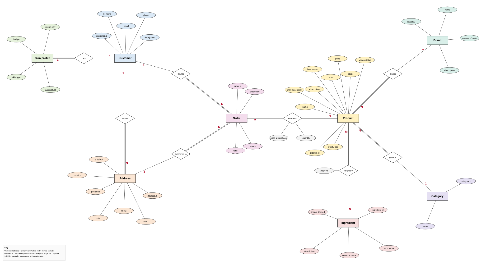

# Chen diagram

The editable version is `03-chen-diagram.drawio`. Open it at app.diagrams.net (File, Open from, Device).

## How to read it

- **Rectangle**: an entity, which becomes a table.
- **Oval**: an attribute. An underlined name is the primary key. A dashed oval is a derived attribute, one that can be worked out from other data (the order total).
- **Diamond**: a relationship, named with a short verb.
- **1, N, M**: the cardinality on each side. `1` to `N` is one-to-many, and `M` to `N` is many-to-many.
- **Double line**: mandatory. Every one of that entity must take part in the relationship. A single line means optional.
- **Ovals on a diamond**: facts that belong to the relationship itself. The quantity and price at purchase belong to "this order contains this product", and the position belongs to "this product is made of this ingredient".

## Relationships shown

| Relationship | Cardinality | Mandatory side |
|---|---|---|
| Customer has Skin profile | one-to-one | Skin profile |
| Customer saves Address | one-to-many | Address |
| Customer places Order | one-to-many | Order |
| Address delivered to Order | one-to-many | Order |
| Brand makes Product | one-to-many | Product |
| Category groups Product | one-to-many | Product |
| Order contains Product | many-to-many | Order |
| Product is made of Ingredient | many-to-many | Product |

These match `01-entities-and-relationships.md`, and the attributes match `02-attributes.md`.
